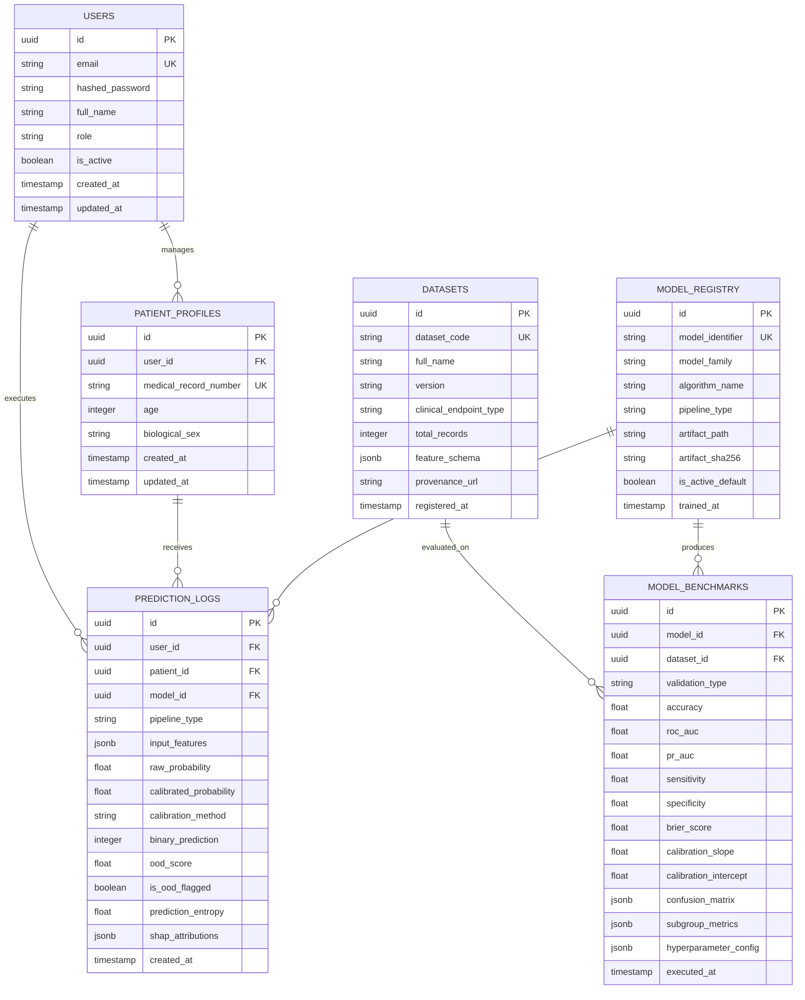

# HeartGuard AI: Relational Database Schema & Data Architecture

**Engine**: PostgreSQL 16  
**ORM**: SQLAlchemy 2.0 (Asyncio / AsyncPG)  
**Migration Manager**: Alembic  
**Date**: November 2026 (Week 1 Phase)

---

## 1. Entity-Relationship Overview

HeartGuard AI employs a normalized relational schema designed to support user authentication, patient profile management, historical prediction auditing, model evaluation benchmarks, and dataset provenance tracking.

---

## 2. Table Specifications & Data Dictionaries

### 2.1 `users` Table
Stores authenticated system users (clinical evaluators and academic researchers).

| Column | Type | Constraints | Description |
| :--- | :--- | :--- | :--- |
| `id` | `UUID` | PRIMARY KEY, default `gen_random_uuid()` | Unique user identifier |
| `email` | `VARCHAR(255)` | UNIQUE, NOT NULL, INDEX | Login email address |
| `hashed_password` | `VARCHAR(255)` | NOT NULL | Bcrypt password hash string |
| `full_name` | `VARCHAR(120)` | NOT NULL | User's full display name |
| `role` | `VARCHAR(32)` | NOT NULL, DEFAULT `'CLINICIAN'` | Role enum: `'RESEARCHER'`, `'CLINICIAN'`, `'ADMIN'` |
| `is_active` | `BOOLEAN` | NOT NULL, DEFAULT `TRUE` | Soft-disable account flag |
| `created_at` | `TIMESTAMPTZ` | NOT NULL, DEFAULT `NOW()` | Account creation timestamp |
| `updated_at` | `TIMESTAMPTZ` | NOT NULL, DEFAULT `NOW()` | Record modification timestamp |

---

### 2.2 `patient_profiles` Table
Stores non-identifying patient demographic profiles for longitudinal tracking.

| Column | Type | Constraints | Description |
| :--- | :--- | :--- | :--- |
| `id` | `UUID` | PRIMARY KEY, default `gen_random_uuid()` | Unique patient identifier |
| `user_id` | `UUID` | FOREIGN KEY (`users.id`), NOT NULL, INDEX | Clinician who created the profile |
| `medical_record_number` | `VARCHAR(64)` | UNIQUE, NOT NULL, INDEX | De-identified internal hospital ID |
| `age` | `INTEGER` | NOT NULL, CHECK (`age` BETWEEN 18 AND 120) | Patient chronological age |
| `biological_sex` | `VARCHAR(10)` | NOT NULL, CHECK (`biological_sex` IN ('MALE', 'FEMALE')) | Biological sex attribute |
| `created_at` | `TIMESTAMPTZ` | NOT NULL, DEFAULT `NOW()` | Registration timestamp |
| `updated_at` | `TIMESTAMPTZ` | NOT NULL, DEFAULT `NOW()` | Profile update timestamp |

---

### 2.3 `datasets` Table
Catalog of benchmark datasets for tracking dataset provenance and schemas.

| Column | Type | Constraints | Description |
| :--- | :--- | :--- | :--- |
| `id` | `UUID` | PRIMARY KEY, default `gen_random_uuid()` | Unique dataset catalog ID |
| `dataset_code` | `VARCHAR(64)` | UNIQUE, NOT NULL, INDEX | E.g., `'UCI_CLEVELAND'`, `'FRAMINGHAM_10YR'` |
| `full_name` | `VARCHAR(255)` | NOT NULL | Full academic dataset name |
| `version` | `VARCHAR(32)` | NOT NULL | Version identifier (e.g., `'1.0.0'`) |
| `clinical_endpoint_type` | `VARCHAR(32)` | NOT NULL | `'DIAGNOSTIC_CAD'` or `'PROGNOSTIC_10YR_CHD'` |
| `total_records` | `INTEGER` | NOT NULL | Total sample count |
| `feature_schema` | `JSONB` | NOT NULL | Schema definition, data types, min/max bounds |
| `provenance_url` | `TEXT` | NOT NULL | Official repository source URL |
| `registered_at` | `TIMESTAMPTZ` | NOT NULL, DEFAULT `NOW()` | Catalog registration date |

---

### 2.4 `model_registry` Table
Tracks trained model artifacts serialized on disk.

| Column | Type | Constraints | Description |
| :--- | :--- | :--- | :--- |
| `id` | `UUID` | PRIMARY KEY, default `gen_random_uuid()` | Model version identifier |
| `model_identifier` | `VARCHAR(128)` | UNIQUE, NOT NULL, INDEX | E.g., `'xgboost_cleveland_v1'` |
| `model_family` | `VARCHAR(64)` | NOT NULL | E.g., `'TREE_ENSEMBLE'`, `'LINEAR'`, `'STACKING'` |
| `algorithm_name` | `VARCHAR(64)` | NOT NULL | E.g., `'XGBClassifier'`, `'LogisticRegression'` |
| `pipeline_type` | `VARCHAR(32)` | NOT NULL | `'DIAGNOSTIC_CAD'` or `'PROGNOSTIC_10YR_CHD'` |
| `artifact_path` | `TEXT` | NOT NULL | Relative path to `.joblib` file |
| `artifact_sha256` | `CHAR(64)` | NOT NULL | Cryptographic SHA-256 integrity hash |
| `is_active_default` | `BOOLEAN` | NOT NULL, DEFAULT `FALSE` | Active production inference model flag |
| `trained_at` | `TIMESTAMPTZ` | NOT NULL, DEFAULT `NOW()` | Training completion timestamp |

---

### 2.5 `model_benchmarks` Table
Stores cross-validation and cross-dataset external validation benchmark results.

| Column | Type | Constraints | Description |
| :--- | :--- | :--- | :--- |
| `id` | `UUID` | PRIMARY KEY, default `gen_random_uuid()` | Benchmark result ID |
| `model_id` | `UUID` | FOREIGN KEY (`model_registry.id`), NOT NULL, INDEX | Evaluated model |
| `dataset_id` | `UUID` | FOREIGN KEY (`datasets.id`), NOT NULL, INDEX | Dataset evaluated on |
| `validation_type` | `VARCHAR(32)` | NOT NULL | `'INTERNAL_STRATIFIED_5CV'`, `'EXTERNAL_TRANSFER'` |
| `accuracy` | `DOUBLE PRECISION`| NOT NULL | Classification accuracy |
| `roc_auc` | `DOUBLE PRECISION`| NOT NULL | Area Under ROC Curve |
| `pr_auc` | `DOUBLE PRECISION`| NOT NULL | Area Under Precision-Recall Curve |
| `sensitivity` | `DOUBLE PRECISION`| NOT NULL | Recall / True Positive Rate |
| `specificity` | `DOUBLE PRECISION`| NOT NULL | True Negative Rate |
| `brier_score` | `DOUBLE PRECISION`| NOT NULL | Probability Brier score |
| `calibration_slope` | `DOUBLE PRECISION`| NOT NULL | Recalibration slope |
| `calibration_intercept`| `DOUBLE PRECISION`| NOT NULL | Calibration-in-the-large intercept |
| `confusion_matrix` | `JSONB` | NOT NULL | JSON dictionary `{"tp": .., "fp": .., "tn": .., "fn": ..}` |
| `subgroup_metrics` | `JSONB` | NOT NULL | Stratified metrics for Male, Female, Age groups |
| `hyperparameter_config`| `JSONB` | NOT NULL | Tuned hyperparameters dictionary |
| `executed_at` | `TIMESTAMPTZ` | NOT NULL, DEFAULT `NOW()` | Benchmark execution timestamp |

---

### 2.6 `prediction_logs` Table
Audit record of every inference execution.

| Column | Type | Constraints | Description |
| :--- | :--- | :--- | :--- |
| `id` | `UUID` | PRIMARY KEY, default `gen_random_uuid()` | Unique prediction event ID |
| `user_id` | `UUID` | FOREIGN KEY (`users.id`), NOT NULL, INDEX | Clinician requesting prediction |
| `patient_id` | `UUID` | FOREIGN KEY (`patient_profiles.id`), NULLABLE, INDEX | Associated patient profile (if linked) |
| `model_id` | `UUID` | FOREIGN KEY (`model_registry.id`), NOT NULL, INDEX | Model executing prediction |
| `pipeline_type` | `VARCHAR(32)` | NOT NULL | `'DIAGNOSTIC_CAD'` or `'PROGNOSTIC_10YR_CHD'` |
| `input_features` | `JSONB` | NOT NULL | Sanitized clinical input parameters |
| `raw_probability` | `DOUBLE PRECISION`| NOT NULL | Model uncalibrated output probability |
| `calibrated_probability`| `DOUBLE PRECISION`| NOT NULL | Post-hoc calibrated risk probability |
| `calibration_method` | `VARCHAR(32)` | NOT NULL | `'PLATT_SIGMOID'`, `'ISOTONIC'`, `'NONE'` |
| `binary_prediction` | `SMALLINT` | NOT NULL | `0` (Negative) or `1` (Positive) |
| `ood_score` | `DOUBLE PRECISION`| NOT NULL | Mahalanobis distance anomaly score |
| `is_ood_flagged` | `BOOLEAN` | NOT NULL, DEFAULT `FALSE` | True if $D^2 > \text{threshold}$ |
| `prediction_entropy` | `DOUBLE PRECISION`| NOT NULL | Shannon prediction entropy $H(\hat{p})$ |
| `shap_attributions` | `JSONB` | NOT NULL | Dictionary of per-feature SHAP attributions |
| `created_at` | `TIMESTAMPTZ` | NOT NULL, DEFAULT `NOW()`, INDEX | Audit timestamp |

---

## 3. Database Indexes and Performance Optimizations

1. **Composite Indexes**:
   - `model_benchmarks(model_id, dataset_id, validation_type)`: Fast lookup for model leaderboard comparisons.
   - `prediction_logs(user_id, created_at DESC)`: Rapid retrieval of user recent prediction history.
   - `prediction_logs(patient_id, created_at DESC)`: Fast patient longitudinal risk trajectory rendering.
2. **JSONB GIN Indexes**:
   - `CREATE INDEX idx_prediction_logs_inputs ON prediction_logs USING GIN (input_features);`
   - `CREATE INDEX idx_benchmark_subgroups ON model_benchmarks USING GIN (subgroup_metrics);`
   Enables high-performance querying of nested feature parameters and subgroup evaluations.
3. **Partitioning Strategy (Future-Proofing)**:
   The `prediction_logs` table is structured to allow range partitioning by `created_at` (e.g., monthly partitions) if inference volume scales during clinical deployment.
