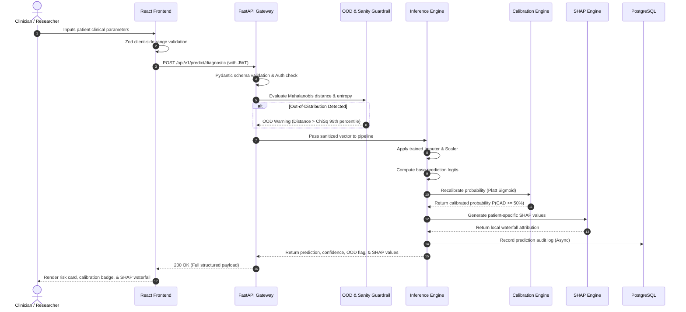
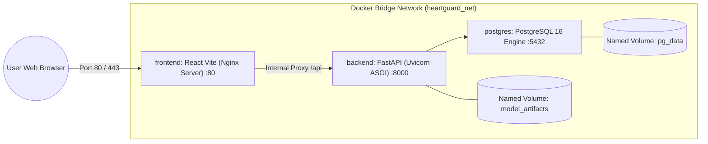

# HeartGuard AI: System Architecture Specification

**Architecture Pattern**: Modular Monolith  
**Application Domain**: Clinical Research Decision-Support & Machine Learning Benchmark Framework  
**Date**: November 2026 (Week 1 Phase)

---

## 1. Architectural Philosophy and System Boundary

HeartGuard AI is designed as a **modular monolith** with clean, decoupled layers separating presentation, application business logic, machine learning lifecycle management, and relational persistence. 

Microservice architectures were evaluated and rejected for this project because:
1. They introduce distributed systems overhead (network latency, eventual consistency, complex deployment orchestration) unnecessary for single-node research platforms.
2. In-memory passing of NumPy arrays and Pandas DataFrames between pipeline components in Python avoids multi-megabyte JSON serialization penalties.
3. A modular monolith provides strict internal domain boundaries while running within a unified Docker Compose network.

> [!IMPORTANT]
> **Research / Educational Regulatory Boundary**:  
> HeartGuard AI is explicitly architected and marked as an **educational and scientific research prototype**, not a CE-marked or FDA-cleared software as a medical device (SaMD). All user interfaces and API payloads carry unambiguous legal and clinical disclaimers.

---

## 2. Component Architecture Overview

```mermaid
graph TD
    subgraph ClientLayer ["Client Presentation Layer (React + Vite + Tailwind)"]
        UI_Dash["Dashboard & Prediction UI"]
        UI_Expl["SHAP Visualizer (Plotly.js)"]
        UI_Bench["Model Benchmark & Cross-Dataset Explorer"]
        UI_Subg["Subgroup & Fairness Auditor"]
    end

    subgraph APILayer ["FastAPI Application Gateway & Controller Layer"]
        Router_Auth["/api/v1/auth (JWT / OAuth2)"]
        Router_Pred["/api/v1/predict (Diagnostic & Prognostic)"]
        Router_Bench["/api/v1/benchmarks & Datasets"]
        Router_OOD["/api/v1/guardrails (OOD & Sanity Checks)"]
        Middleware["CORS, Rate Limiting, Security Headers"]
    end

    subgraph CoreMLLayer ["Machine Learning Engine (Python / Scikit-learn / XGBoost / SHAP)"]
        MOD_Data["Data Processing & Cleaning Module"]
        MOD_Train["Model Training & Tuning Pipeline"]
        MOD_Infer["Inference & Batch Prediction Engine"]
        MOD_Calib["Calibration Engine (Platt / Isotonic)"]
        MOD_SHAP["Explainability Engine (TreeSHAP / KernelSHAP)"]
        MOD_Fair["Fairness & Subgroup Auditing Engine"]
        MOD_OOD["Uncertainty & Mahalanobis OOD Detector"]
    end

    subgraph PersistenceLayer ["Persistence & Storage Layer"]
        PostgresDB[("PostgreSQL 16 Engine")]
        ModelStore[("Model Artifact Storage (Joblib / Metadata JSON)")]
        DataStore[("Canonical Dataset Archives (CSV / Parquet)")]
    end

    ClientLayer <-->|REST API / JSON / HTTPS| APILayer
    APILayer --> CoreMLLayer
    APILayer <-->|SQLAlchemy ORM (Async)| PostgresDB
    CoreMLLayer <-->|File I/O / Serialization| ModelStore
    CoreMLLayer <-->|Read Only| DataStore
```

---

## 3. Detailed Module Specifications

### 3.1 Client Presentation Layer (React + Vite + Tailwind CSS + Plotly)
- **Framework**: React 18, Vite build tooling, Tailwind CSS utility styling.
- **Data Visualization**: Plotly.js / `react-plotly.js` for interactive calibration curves, ROC/PR curves, SHAP beeswarm/waterfall plots, and confusion matrices.
- **State Management**: TanStack React Query for cached asynchronous server state; React Context for authentication session tokens.
- **Client-Side Form Validation**: React Hook Form coupled with Zod schemas matching backend Pydantic definitions to provide immediate feedback on out-of-range clinical inputs.

### 3.2 FastAPI Backend Application Layer
- **Framework**: FastAPI (Python 3.11+) utilizing asynchronous ASGI (`uvicorn`).
- **Data Validation & Serialization**: Pydantic v2 schemas providing strict compile-time and runtime type checking.
- **Authentication & Authorization**:
  - Stateless JSON Web Tokens (JWT) signed using HMAC-SHA256 (`HS256`).
  - Passwords hashed using `bcrypt` (work factor 12).
  - Role-Based Access Control (RBAC): `RESEARCHER` (access to all benchmark logs and training triggers) and `CLINICIAN_USER` (access to patient profiles and prediction assessments).
- **API Versioning**: Canonical `/api/v1` namespace prefix for long-term route stability.

### 3.3 Core Machine Learning Engine
- **`data_processing`**: Separate loaders for Pipeline A (UCI collection) and Pipeline B (Framingham). Implements anti-leakage transformers (median imputation, standardization) encapsulated in pipelines.
- **`training_pipeline`**: Executes nested cross-validation, hyperparameter optimization (`Optuna`), and exports standardized `.joblib` bundles containing fitted estimators, preprocessing transformers, and performance metadata.
- **`inference_engine`**: High-throughput prediction service loading serialized pipelines into memory on application startup with warm cache.
- **`calibration_engine`**: Implements post-hoc Platt scaling and Isotonic regression; computes Brier score, ECE, calibration slope, and calibration intercept.
- **`explainability_engine`**: Wraps `shap.TreeExplainer` for tree models and `shap.LinearExplainer` for regularized logistic regression, formatting explanation payloads for frontend rendering.
- **`fairness_engine`**: Calculates disaggregated metrics across age and sex cohorts; computes Equalized Odds differentials and Demographic Parity metrics.
- **`uncertainty_ood_engine`**: Evaluates multivariate Mahalanobis distances against training covariance matrices, returning continuous anomaly scores and binary OOD flags.

### 3.4 Persistence and Artifact Storage Layer
- **Relational Database**: PostgreSQL 16 managed via `SQLAlchemy 2.0` (async engine with `asyncpg`) and migration versioning via `Alembic`.
- **Model Artifact Storage**: Dedicated filesystem directory (`/app/artifacts/models/`) storing model bundles serialized with `joblib`. Each artifact is accompanied by a cryptographic SHA-256 hash and a manifest JSON documenting training commit, dataset versions, and benchmark metrics.

---

## 4. End-to-End Data Flow



---

## 5. Security and Compliance Architecture

1. **Secrets Management**: No hardcoded API keys, JWT secrets, or database credentials. All runtime secrets loaded via environment variables (`pydantic-settings`).
2. **CORS Configuration**: Restrictive Cross-Origin Resource Sharing policy explicitly whitelisting authorized frontend origin domains.
3. **Data Protection at Rest & In Transit**:
   - In Transit: Enforced TLS 1.3 via reverse proxy (Nginx / Caddy in production).
   - At Rest: Sensitive database credentials and patient identifiers encrypted.
4. **Input Sanitization**: Pydantic validates boundaries on all inputs to protect against numeric overflow, NaN injection, and malformed inputs.
5. **No Medical Device Claim Disclaimer**: Every API response containing risk estimates includes a mandatory disclaimer payload:
   ```json
   {
     "disclaimer": "HeartGuard AI is an academic research prototype and decision-support demonstration tool. Predictions are not certified medical diagnoses."
   }
   ```

---

## 6. Docker Containerization and Deployment Architecture

The entire platform is orchestrated via `docker-compose.yml` defining three isolated services:



- **Build Profiles**: Development (hot reload via volume mounts) and Production (multi-stage minimal Docker builds).
- **Health Checks**: Built-in container health checks (`/health` endpoint on FastAPI and `pg_isready` on PostgreSQL).
