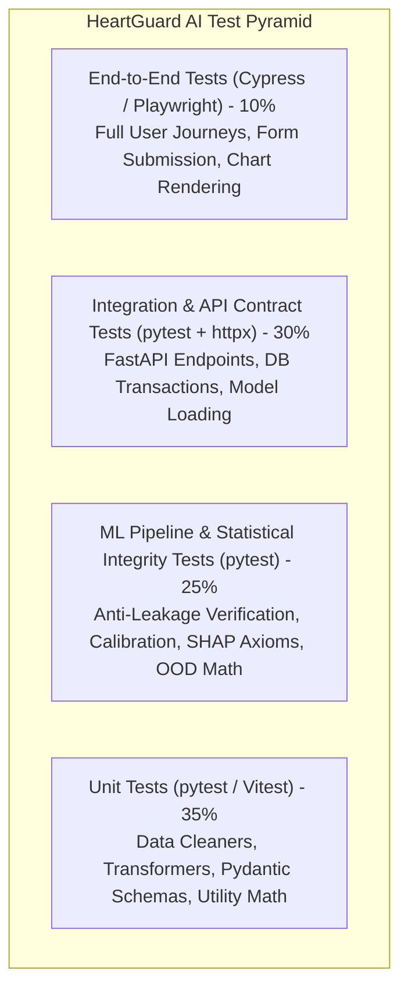

# HeartGuard AI: Quality Assurance & Testing Strategy

**Lead Quality Architect**: Principal ML Research Engineer  
**Date**: November 2026 (Week 1 Phase)  
**Standard**: IEEE 829-2008 (Standard for Software and System Test Documentation)

---

## 1. Quality Objectives and Testing Pyramid

HeartGuard AI operates in a safety-critical clinical decision-support domain. The testing strategy enforces rigor across statistical correctness, machine learning integrity, data hygiene, API contracts, and user interface workflows.



---

## 2. Test Classification & Coverage Targets

| Test Category | Target Coverage | Framework / Tool | Primary Focus |
| :--- | :--- | :--- | :--- |
| **Unit Tests (Backend)** | $\ge 90\%$ line coverage | `pytest`, `pytest-cov` | Pydantic validation, math transforms, Mahalanobis distances, entropy calculation |
| **ML Pipeline Integrity** | $100\%$ critical path | `pytest`, `numpy.testing` | Anti-leakage assertions, pipeline encapsulation, zero-variance feature handling |
| **Integration & API Tests** | $\ge 85\%$ endpoint coverage | `pytest`, `httpx`, `pytest-asyncio` | FastAPI routers, JWT authentication, PostgreSQL CRUD, model serialization |
| **Statistical & Calibration**| $100\%$ metric logic | `pytest`, `scikit-learn` | Brier score math, calibration slope/intercept computation, Platt fitting bounds |
| **Unit Tests (Frontend)** | $\ge 80\%$ component logic | `Vitest`, `@testing-library/react` | Form inputs, error banners, disclaimers, state stores |
| **End-to-End (E2E)** | Key clinical flows | `Playwright` | Login $\rightarrow$ Patient Profile $\rightarrow$ Diagnostic Prediction $\rightarrow$ SHAP rendering |

---

## 3. Specialized Machine Learning Quality Assertions

### 3.1 Data Leakage Prevention Tests (`tests/ml/test_leakage.py`)
- **Objective**: Mathematically prove that no test fold information is observed during preprocessing.
- **Test Implementation**:
  1. *Imputation Isolation*: Verify that the median value used to fill missing entries in fold $K_{\text{test}}$ matches $\text{median}(K_{\text{train}})$ and does not change when $K_{\text{test}}$ values vary.
  2. *Scaling Isolation*: Verify that `StandardScaler` mean and standard deviation equal the training fold statistics exactly.
  3. *SMOTE Boundary*: Assert that synthetic sample generation occurs exclusively on training sets; verify that test set sample count and label distribution remain untouched.

### 3.2 Probability Calibration Verification Tests (`tests/ml/test_calibration.py`)
- **Objective**: Verify that calibration routines output valid probabilities and reduce Brier error.
- **Test Implementation**:
  1. *Range Invariance*: Assert that all calibrated probabilities $\hat{p}_{\text{cal}} \in [0.0, 1.0]$.
  2. *Monotonicity*: Assert that Platt sigmoid scaling preserves the relative ordering of raw logits (rank-order correlation $= 1.0$).
  3. *Brier Score Correctness*: Assert that a model predicting true event prevalence achieves a lower Brier score than an uninformative 50/50 prior on imbalanced data.

### 3.3 Explainability Axiom Tests (`tests/ml/test_shap.py`)
- **Objective**: Verify that SHAP attributions satisfy mathematical game-theoretic axioms.
- **Test Implementation**:
  1. *Local Accuracy (Efficiency)*: For any patient vector $x$, assert:
     $$\left| \left( \phi_0 + \sum_{i=1}^M \phi_i(x) \right) - f(x) \right| < 10^{-5}$$
     where $\phi_0$ is expected model output and $f(x)$ is prediction output.
  2. *Missingness*: Assert that features with zero influence have exactly zero attribution.
  3. *Dimension Consistency*: Assert that the length of the SHAP vector matches the feature schema count exactly.

### 3.4 Out-of-Distribution (OOD) Guardrail Tests (`tests/ml/test_ood.py`)
- **Objective**: Ensure impossible or anomalous patient inputs are detected and flagged.
- **Test Implementation**:
  1. *In-Distribution Sanity*: Verify that patient vectors drawn from the empirical training distribution yield Mahalanobis distances below the 99th percentile $\chi^2$ cutoff.
  2. *Out-of-Bounds Rejection*: Feed synthetic vectors with physiological outliers (e.g., blood pressure $= 300\text{ mmHg}$, cholesterol $= 900\text{ mg/dL}$) and assert that `is_ood_flagged == True`.
  3. *Boundary Inversion*: Assert that non-invertible covariance matrices trigger robust pseudo-inverse fallback (`numpy.linalg.pinv`) without throwing unhandled exceptions.

---

## 4. API & Integration Test Suite (`tests/api/`)

- **`test_auth.py`**:
  - Test registration with valid, duplicate, and weak passwords.
  - Test login with valid credentials (returns 200 + valid JWT).
  - Test unauthorized endpoint access (returns 401 Unauthorized).
  - Test expired and tampered JWT tokens.
- **`test_prediction_diagnostic.py`**:
  - Test `POST /api/v1/predict/diagnostic` with valid 13-feature UCI vector.
  - Verify presence of `calibrated_probability`, `brier_score`, `ood_score`, and `shap_attributions` in response.
  - Test missing required field (returns 422 Unprocessable Entity).
  - Test out-of-range clinical value (returns 422 with specific field error message).
- **`test_prediction_prognostic.py`**:
  - Test `POST /api/v1/predict/prognostic` with valid Framingham vector.
  - Assert that attempting to pass UCI features to the Framingham endpoint is rejected.
- **`test_model_benchmarks.py`**:
  - Test `GET /api/v1/benchmarks` returns complete comparison table across all 10 algorithms.
  - Test `GET /api/v1/benchmarks/cross-dataset` returns degradation metrics for Hungary, Long Beach, and Switzerland.

---

## 5. Automated CI/CD Testing Pipeline

HeartGuard AI implements automated GitHub Actions / GitLab CI workflows on every commit and pull request:

```yaml
# Conceptual CI Pipeline Stages
stages:
  - lint-and-typecheck:
      steps:
        - flake8 / ruff check .
        - black --check .
        - mypy src/ --strict
  - ml-integrity-tests:
      steps:
        - pytest tests/ml/ -v --cov=src/ml
  - api-integration-tests:
      steps:
        - docker-compose up -d postgres_test
        - pytest tests/api/ -v --cov=src/api
  - security-audit:
      steps:
        - bandit -r src/
        - safety check
```

---

## 6. Viva Demonstration & Acceptance Testing Protocols

Prior to final submission and viva examination, the developer will execute a reproducible acceptance validation run:
1. **Fresh Environment Build**: `docker-compose down -v && docker-compose up --build -d`
2. **Database Migration & Seed**: `alembic upgrade head && python scripts/seed_benchmarks.py`
3. **Automated Test Run**: `pytest tests/ -v --cov=src --cov-report=html`
4. **End-to-End Verification Check**: Verify interactive dashboard displays live Plotly charts, SHAP waterfalls, calibration badges, and cross-dataset degradation matrices.

